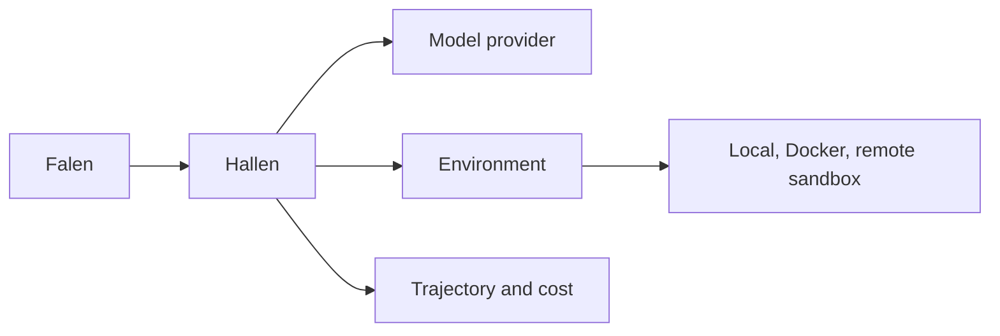

<div align="center">


<h1>Hallen</h1>

<p><strong>The code harness for the Falen ecosystem</strong></p>

<p>
  
  
  
  
</p>

</div>

---

Hallen runs coding agents against real work environments and it is built to be driven by other software rather than by a person. It is a fork of [mini-swe-agent](https://github.com/SWE-agent/mini-swe-agent), the minimal agent from the SWE-bench team.

## How it fits



Falen owns the task graph, the planning policy, the context budget and the evaluation loop. Hallen owns the agent step, the shell action and the record of what happened.

## Quick start

```python
from minisweagent.run.prompt import run_prompt

result = run_prompt(
    "Fix the failing test in src/app.py",
    model_name="anthropic/claude-sonnet-4-5-20250929",
    output_path="runs/task-1.traj.json",
)

result["success"]  # True when the agent submitted its output
```

`run_prompt` builds the model, the environment and the agent from the built in config, runs the loop and returns a dictionary. The `success` key is `True` only when the agent finished with `exit_status` equal to `Submitted`. Any other ending, such as a cost limit or a repeated format error, reports `False`. The same dictionary carries the exit status, the submission, the total cost, the number of model calls and the trajectory path.

Pass `environment_class="docker"` or a config spec to change where commands run. You can also pass your own model and environment objects and skip the factories.

## What it does

Hallen executes shell actions in an environment, records every message and its cost, and writes the full trajectory as JSON. Environments can be local processes, containers or remote sandboxes, and the same agent works with any of them.

The harness is headless. There is no terminal UI, no interactive confirmation prompt and no console entry point. Your code builds the model and the environment, hands them to the agent, and reads the result.

## Design rules

The core loop is one file. The rest of the package is optional pieces that you can replace.

The agent uses bash only and a short system prompt, so there are no tool schemas to pay for on every call.

Every command runs in a fresh subshell. That makes runs reproducible and easy to move into a sandbox.

Each call reports its cost, and each run saves a trajectory with the full message history.

Model, environment and agent are separate interfaces. You can swap a provider or a sandbox without touching the loop.

## What we removed

We dropped the interactive agent, the terminal inspector and the command line tools that only existed for a human operator. A harness that is called from code does not need a prompt loop, a confirmation dialog or a progress bar.

## Upstream

Hallen is forked from [SWE-agent/mini-swe-agent](https://github.com/SWE-agent/mini-swe-agent). The original project and its benchmark results remain the reference point for this work. See [LICENSE.md](LICENSE.md).

## Development

```bash
pip install -e '.[dev]'
pytest -n auto
```
